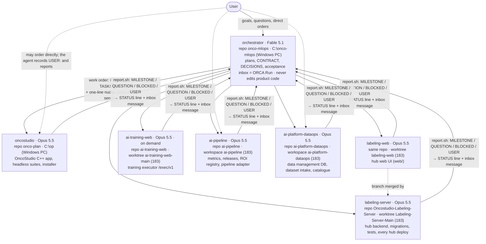
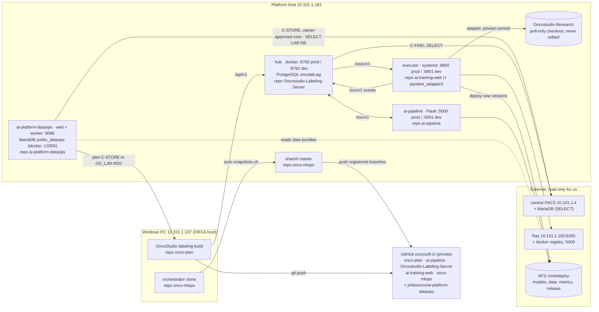

# Agent structure, system architecture with repositories, and the ORCA setup

This page is the one to read when you want to run the platform's agents yourself or understand who orders whom.
Values (ids, hosts, models, commands) come from `workspaces.env` and `WORKSPACES.md` in this repo, which stay the
source of truth; this page explains them.

## 1. Recommended agent structure

One orchestrator the person talks to; one role agent per system, each in its own workspace (a directory of that
system's repository) and owning only that directory. Roles are stable; people, paths and terminal ids change.



Rules that make this work (`COLLABORATION.md`):

- **Files are the truth, the terminal is the fast path.** Every order is a `FOR <role>:` line in the role's STATUS
  file or a `plans/<date>-<name>/TASKS_<role>.md`; every report is a line in that STATUS file. The typed nudge only
  points at the file. A role that loses its terminal continues from `CLAUDE.md` + its STATUS file.
- **One owner per directory.** A change that needs two roles starts with a contract change (version bump in
  `CONTRACT.md`, entry in `DECISIONS.md`, documentation page), then producer, then consumer.
- **The owner deploys** after its proof passes; the orchestrator sequences cross-role deploys and accepts by
  checking something observable, never by trusting a claim.
- **Never block on another role.** Build against the contract and the peer's mock, ship backward compatible, leave a
  `FOR` line.
- **Renewal.** An agent that has compacted, lived across a working day or shows "Restart to update" is renewed when
  idle (`scripts/renew.sh <role>|all`); the fresh agent reports `READY` and continues from the files.

| Role | Model | Host | Workspace | Repository · branch | STATUS file |
|---|---|---|---|---|---|
| orchestrator | Fable 5.1 | Windows PC | `C:\onco-mlops` | `onco-mlops` · `main` | `STATUS.md` |
| oncostudio | Opus 5.5 | Windows PC | `C:\op` | `onco-plan` · `feature/labeling-provenance` | `mlops_platform/STATUS.md` |
| labeling-server | Opus 5.5 | 183 | hub worktree `…-Labeling-Server-Main` | `Oncostudio-Labeling-Server` · `Labeling-Server-Main` | `handoff/STATUS.md` |
| labeling-web | Opus 5.5 | 183 | hub worktree `…-labeling-web` | `Oncostudio-Labeling-Server` · `labeling-web` | `handoff/STATUS-web.md` |
| ai-training-web | Opus 5.5 | 183 | `…/ai-training-web-ai-training-web-main` | `ai-training-web` · `ai-training-web-main` | `handoff/STATUS.md` |
| ai-pipeline | Opus 5.5 | 183 | `…/ai-pipeline` (the production tree) | `ai-pipeline` · `mlops-phase1` | `handoff/STATUS.md` |
| ai-platform-dataops | Opus 5.5 | 183 | `…/ai-platform-dataops` (the production tree) | `ai-platform-dataops` (GitHub `jmleeonco`) · `main` | `handoff/STATUS.md` |

Model ids: `claude-fable-5-1` for the orchestrator, `claude-opus-5-5` for every implementer
(`MODEL_ORCHESTRATOR`, `MODEL_IMPLEMENTER` in `workspaces.env`). Watchers and waiters the orchestrator spawns for
long waits (training jobs, reports) run on Sonnet and are read-only.

## 2. System architecture with repositories



Hosts, ports and the numbered integration flows: `ARCHITECTURE.md`. Which repository holds what:
`docs/platform/REPOSITORIES.md`. Deploy commands per role: `WORKSPACES.md`, `RUNBOOK.md`.

## 3. ORCA setup

ORCA is the agent development environment on the Windows PC that hosts every agent's terminal and lets the
orchestrator drive the others. Nothing in the protocol depends on it (section 1: files are the truth); it is the
live channel. The settings that matter are in `workspaces.env`, overridable by environment variables:

| Setting | Value / variable | What it is |
|---|---|---|
| ORCA host | the Windows PC `10.101.1.107` | the only machine that can create, read and type into other agents' terminals |
| Workspaces | one ORCA workspace per role, named after the role, rooted at the role's directory | `orca.sh` finds a role's terminal by its workspace path, never by a terminal id |
| Orchestrator inbox | `ORCA_RUN` (`ONCO_ORCA_RUN`), an ORCA Run | `report.sh` drops every role report into it; `inbox.sh bind` / `peek` / `wait` reads it; every message is also a STATUS line, so nothing is lost if the Run is gone |
| 183 terminals | managed SSH server `ubuntu@10.101.1.183` paired in ORCA; fallback `ORCA_ENV_183` (`ONCO_ORCA_ENV_183`) | when ORCA's SSH relay is detached, `orca.sh` and `renew.sh` create and reach 183 terminals through the paired Orca server (`orca.sh list` shows `[via ubuntu@10.101.1.183]`) |
| Platform host | `HOST183` (`ONCO_HOST`) | ssh target every script uses for 183 |
| Agent launch | `WS_AGENT[<role>]` | the `claude` command per role: `--model` from `WS_MODEL`, permission mode `bypassPermissions` on the PC, `--dangerously-skip-permissions` on 183 |
| Model pin | `.claude/settings.local.json` in each workspace (`{"model": "claude-opus-5-5"}`; untracked, per machine) | a terminal started by hand gets the same model |
| Skills | `skills/mlops` (orchestrator) and `skills/platform-role` (roles) | installed with `scripts/install-skills.sh` (PC) and `--183`; `/mlops` and `/platform-role` |

Daily commands (all from `C:\onco-mlops`, Git Bash):

```sh
bash scripts/inbox.sh bind && bash scripts/inbox.sh peek   # session start: own the inbox, read what arrived
bash scripts/status.sh 2                                   # every role's last milestones and open FOR lines
bash scripts/orca.sh list                                  # live agents per role (several per role is possible)
bash scripts/branches.sh                                   # every system on its registered branch (U37)
bash scripts/orca.sh start <role> --brief                  # open a role's terminal with its model and brief it
bash scripts/orca.sh send <role> "Work order: FOR line of <time> in your STATUS file. Report with scripts/report.sh."
bash scripts/orca.sh read <role> 40                        # look at a busy agent's screen
bash scripts/renew.sh <role>… | all                        # renew idle agents (fresh briefed terminal, READY report)
bash scripts/jobs.sh [ids]                                 # read-only end-to-end monitor of hub training jobs
bash scripts/sync-snapshots.sh                             # push the shared repo, refresh handoff/ snapshots, push every registered branch to GitHub
```

### Reproducing the setup on another machine

1. Clone `onco-mlops` (the coordination repo) and the systems you will drive; put each system on its registered
   branch (`WORKSPACES.md`).
2. Export the overrides for your environment: `ONCO_HOST` (the platform host), `ONCO_ORCA_RUN` (create a Run with
   `orca orchestration run-create --objective "Onco MLOps platform — orchestrator inbox"`), `ONCO_ORCA_ENV_183`
   (the paired Orca server), or edit `workspaces.env` and commit when the change is permanent.
3. In ORCA, create one workspace per role rooted at the role's directory, named after the role; pair the SSH host.
4. `bash scripts/install-skills.sh` (and `--183`), then open the orchestrator terminal in `C:\onco-mlops` with the
   `WS_AGENT[orchestrator]` command and start the session (`/mlops`, section 0).
5. Without ORCA at all: start each agent with `cd <workspace> && claude`; orders travel as `FOR` lines
   (`post.sh` works from any machine with ssh to the host), reports degrade to STATUS lines, the orchestrator reads
   `status.sh` instead of the inbox (`COLLABORATION.md` §8).
